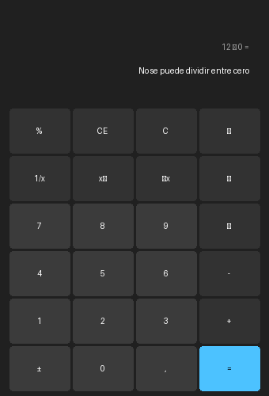

# Entrega Tema 1: Calculadora de Escritorio en Python
**Asignatura:** Robots Móviles Autónomos / Robótica Colaborativa  
**Estudiante:** Víctor  
**Fecha:** Octubre 2026  

---

## 1. Qué hace la aplicación
Aplicación de escritorio interactiva desarrollada en **Python** con **Tkinter**, inspirada en la Calculadora Estándar de Windows 11 en modo oscuro.

- **Operaciones Aritméticas Básicas:** Suma (`+`), resta (`-`), multiplicación (`×`), división (`÷`).
- **Operaciones Extendidas:** Cálculo de recíproco (`1/x`), potencia al cuadrado (`x²`), raíz cuadrada (`√x`), cálculo porcentual (`%`) e inversión de signo (`±`).
- **Historial de Operación:** Indicador visual superior con la expresión en curso y el operador activo antes de resolver.
- **Entrada por Teclado:** Soporte para entrada numérica del teclado (teclado estándar y teclado numérico), `Enter` para resolver, `BackSpace` para borrar dígitos y `Escape` para limpiar (`C`).

---

## 2. Controles habituales y gestión de errores (Tema 1)

Siguiendo las pautas del **Tema 1 (Pruebas, Gestión de Errores y Depuración)**:

| Tipo de Control | Comportamiento Implementado | Resultado en Pantalla |
|---|---|---|
| **División entre Cero (`÷ 0`)** | Bloqueo preventivo de `ZeroDivisionError` en `_execute_op` y recíproco `1/x`. | Muestra `"No se puede dividir entre cero"` sin bloquear ni cerrar la aplicación. |
| **Control de Entrada (Sin Letras)** | Bloqueo estricto en `btn_digit()` (`digit in "0123456789"`) y mapeo exclusivo de teclas numéricas en `_bind_keys()`. No hay campos de texto libre. | Imposible introducir caracteres alfabéticos o texto no numérico. |
| **Raíz Cuadrada Negativa (`√x` con $x < 0$)** | Detección previa antes de llamar a `math.sqrt()`. Captura de `ValueError`. | Muestra `"Entrada no válida"`. |
| **Desbordamiento (Overflow)** | Captura de `OverflowError`, `math.isinf()` y `math.isnan()` en multiplicaciones o potencias elevadas. | Muestra `"Desbordamiento"`. |
| **Límite de Longitud / Buffer** | Límite máximo de 16 dígitos significativos para evitar saturación de memoria. | Ajuste dinámico de fuente y corte seguro. |
| **Reseteo tras Error** | Al pulsar cualquier dígito tras un error, el estado se limpia automáticamente. | Permite comenzar un nuevo cálculo sin necesidad de reiniciar la app. |

---

## 3. Captura y Diseño de la Interfaz



---

## 4. Cómo ejecutarla

### Requisitos
- Python 3.10 o superior (verificado con Python 3.14).
- Tkinter (incluido en la distribución oficial de Python para Windows).

### Ejecución
Desde la terminal en esta carpeta:
```powershell
python calculadora_windows.py
```

---

## 5. Tabla de Pruebas Realizadas

| Entrada y Acción | Valor Esperado | Valor Obtenido | ¿Correcto? |
|---|---|---|:---:|
| `12 + 8 =` | `20` | `20` | Sí |
| `15 ÷ 0 =` | `"No se puede dividir entre cero"` | `"No se puede dividir entre cero"` | Sí |
| `0` seguido de `1/x` | `"No se puede dividir entre cero"` | `"No se puede dividir entre cero"` | Sí |
| `9` seguido de `±` y `√x` | `"Entrada no válida"` | `"Entrada no válida"` | Sí |
| `12.5 × 2 =` | `25` | `25` | Sí |
| Pulsar letras en teclado (`A`, `B`, `Z`) | Entrada ignorada (solo dígitos) | Entrada ignorada | Sí |
| `5 +` seguido de `×` y `2 =` | Cambio fluido de operador (`10`) | `10` | Sí |

---

## 6. Estructura del Módulo

```text
01_calculadora_interfaz/
├── calculadora_windows.py    # Código fuente principal de la aplicación
├── requirements.txt          # Especificación de dependencias
├── docs/                     # Diagramas y recursos gráficos de la interfaz
└── README.md                 # Informe y documentación de entrega
```
